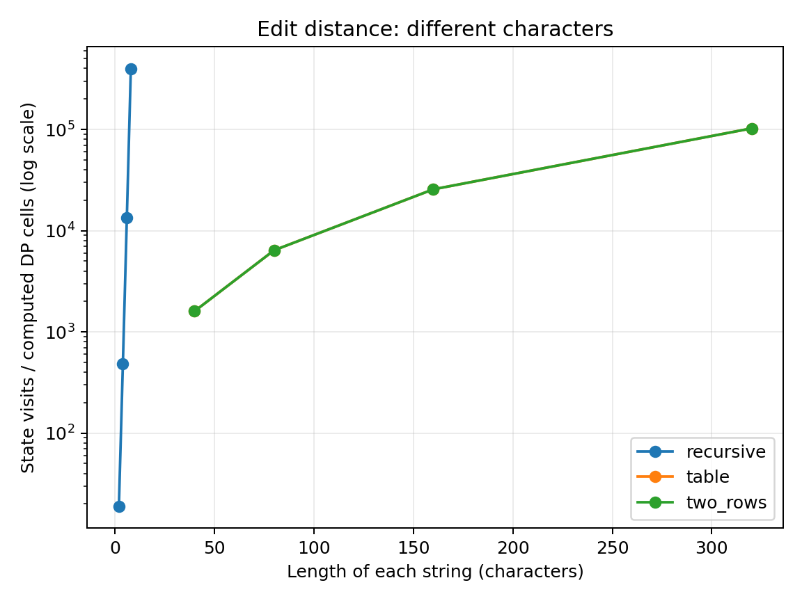
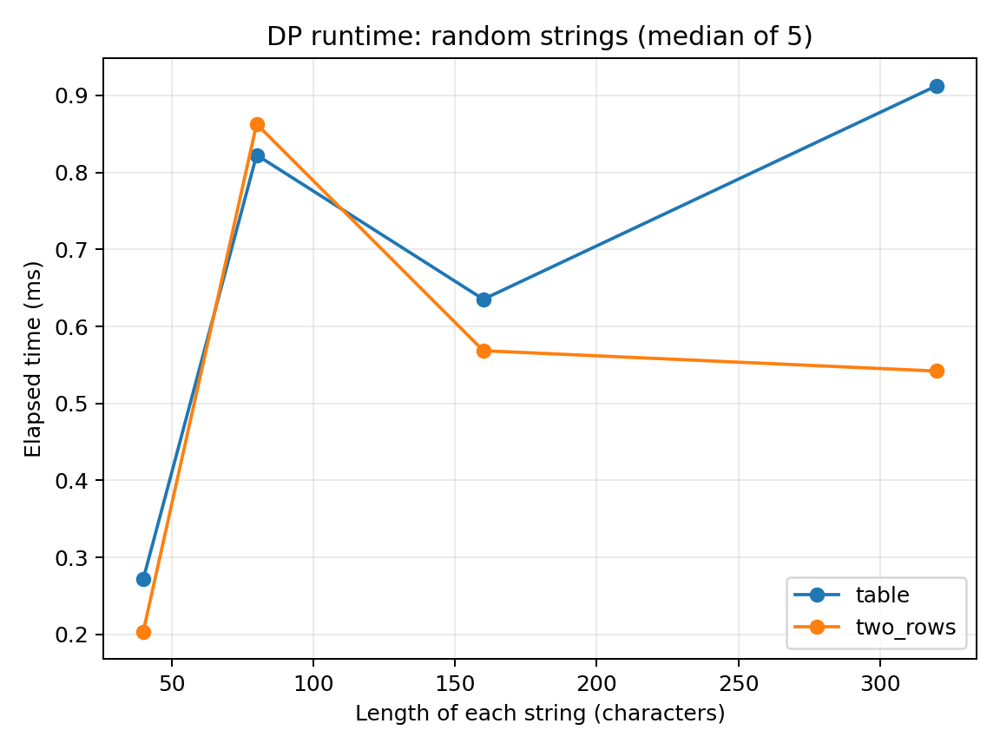
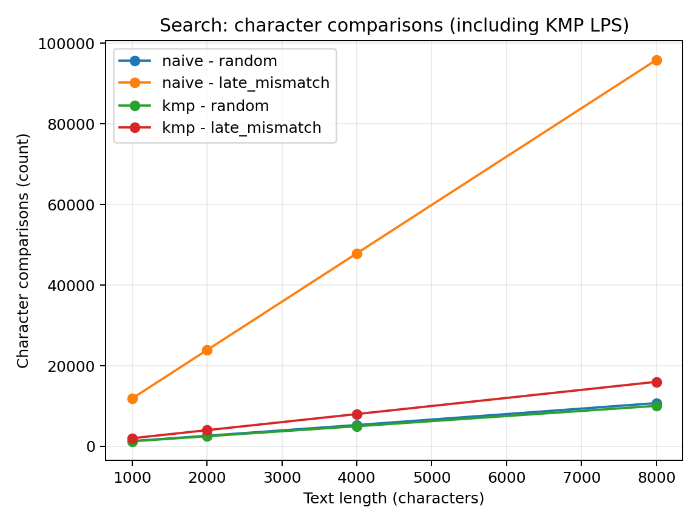
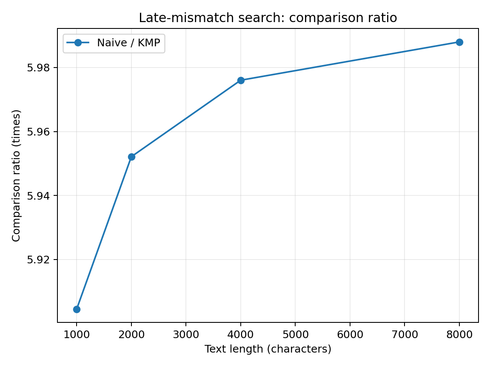

# Assignment 4 Report — City Search & Spell-Check

**Yerkinbek Arsen — SE-2516**  
Design and Analysis of Algorithms

## 1. Experiment Design Card (planned before running)

| Field | Edit Distance | String Search |
|---|---|---|
| Question | How quickly does plain recursion become expensive, and does storing only two DP rows change the number of computed cells? | When does KMP avoid character comparisons compared with a naive search? |
| Sizes (n) | Recursion: **2, 4, 6, 8** characters per string; DP: **40, 80, 160, 320**. I kept recursion small because its growth is exponential. Both sets have at least four sizes and a 4x range. | Text: **1,000, 2,000, 4,000, 8,000** characters, pattern fixed at **12**. Doubling n makes the trend visible. |
| Inputs | `random`: two fixed-seed strings from a four-letter alphabet; `different`: `a` repeated n times versus `b` repeated n times to force branching in recursion. | `random`: fixed-seed text/pattern using four letters; `late_mismatch`: text of only `a`, pattern of 11 `a` letters and a final `b` to force long failed comparisons in Naive. |
| Metrics | Wall-clock milliseconds plus recursive state visits / DP computed cells. Counts show the repeated work without relying only on speed. | Wall-clock milliseconds plus character comparisons. KMP includes LPS-building comparisons. |
| Prediction | Recursive visits should rise very fast for all-different strings. Both DP approaches should compute n² cells. Their time may differ because of memory allocation and cache behavior. | Naive should make many more comparisons on late mismatches. KMP should grow roughly linearly with text length. |
| Plots | DP cell/state counts on a log axis; median DP runtime. | Comparisons by method/input; Naive-to-KMP comparison ratio. |

**Reproducibility:** The input generator uses fixed seeds (`20261108 + n` and `20261108 + 37n`). Each case runs five times. `results/results.csv` stores one row **per measured run**, not only a summary. The curves use the **median of five** times or counts for each combination. The same command regenerates identical input strings and operation counts, but elapsed times naturally change depending on JIT warm-up and other CPU activity. This is why raw times are not treated as perfectly reproducible.

## 2. Plots and results

*Figure 1. On different strings, recursive visits explode much faster than DP cells; the y-axis is logarithmic.*

For the `different` case, recursion visited **19, 481, 13,483, and 398,593** states for n=2,4,6,8. By comparison, each DP method computed **1,600, 6,400, 25,600, and 102,400** cells for n=40,80,160,320. Different length ranges were intentional: running large sizes recursively would be impractical.

*Figure 2. Both DP methods remain usable at n=320; the measured milliseconds are noisy and do not rise smoothly at every step.*

For random strings of size 320, Table used a median **0.91275 ms** and Two Rows **0.54204 ms** in this run. Both performed **102,400** cell computations. The timing gap reflects implementation/runtime effects, not a better big-O time complexity: both are O(n²) on equal-length inputs.

*Figure 3. Naive matching performs many extra comparisons on the late-mismatch input, but both methods are much closer on random input.*

For 8,000 text characters, late-mismatch Naive performed **95,868** comparisons while KMP performed **16,010** (including LPS preprocessing). On random input, the corresponding counts were **10,725** and **10,049**. The special text makes the worst-case difference clearer than random data alone.

*Figure 4. The late-mismatch Naive/KMP comparison ratio stays near six because the pattern length is fixed at 12.*

## 3. Prediction versus actual result

**Edit Distance.** I expected recursion to be bad on strings that do not match, and the counters confirm that. Even at n=8, the recursion makes almost four hundred thousand visits in the all-different case. Full-table and two-row DP compute exactly the same number of cells for the same pair of lengths, which also agrees with the prediction. Their recorded times are less consistent because they are very short operations in a JVM.

**String Search.** I expected KMP to benefit more from a repeated-prefix pattern than from a random one. That is what the comparison counts show. The difference grows with text size in absolute number of comparisons. Since the pattern stays length 12, Naive is still linear in n in this particular experiment; it would approach O(nm) when pattern length m also grows.

## 4. Short answers

**Which input made string search slowest, and why?**  
The `late_mismatch` input was the hardest for Naive according to the comparison counter. Each starting position matches 11 `a` characters and fails only on the final `b`, causing up to 12 comparisons per position. KMP reuses information from the matched prefix through its LPS array, so it avoids doing all of that work again. On this input the difference is visible even with a small, fixed-length pattern.

**How large an n could recursive Edit Distance handle, and what stopped it?**  
I tested recursion up to n=8 in the controlled experiment. On the all-different input it already reached 398,593 recursive state visits. It could handle larger strings depending on the available time, but the growth becomes impractical very quickly because the same subproblems are solved again and again. I stopped at eight on purpose to keep the whole benchmark quick and repeatable.

**What do you gain and lose with two rows instead of the full table?**  
Two rows reduce extra memory from O(nm) to O(min(n,m)), because the code only needs the previous and current row to compute the final distance. The distance value and the number of computed cells stay the same. The downside is that the whole DP table is not available afterward, so reconstructing the actual edit sequence is not straightforward. I would use two rows when I only need the distance, not the sequence of edits.

**Which search would I choose for the city platform?**  
I would choose KMP for scanning long logs, especially when the pattern has repeated prefixes or the text contains many near-matches. It has predictable O(n+m) worst-case time and returns overlapping matches correctly. Naive search is shorter and easy to maintain, so it is fine for tiny inputs. For large log files, the stronger worst-case guarantee of KMP is more valuable.

## 5. About timing

All measurements were taken with `System.nanoTime()` and written in milliseconds for five runs of each case. Java just-in-time compilation, garbage collection, CPU scheduling, and memory allocation affect these small timings, so one method can occasionally appear slower at a smaller size. I used medians to reduce outlier effects, but the experiment is still a small laptop-style benchmark rather than a rigorous JVM performance study. For explaining complexity I rely mainly on counts collected inside the algorithms, together with theory and the measured time trends.

## 6. Files

- `src/main/java/kz/sdu/daa/` — algorithms, counters, input generator and experiment driver.
- `src/test/java/kz/sdu/daa/` — JUnit 5 reference, edge-case, and 100-random-case tests.
- `results/results.csv` — 200 individual runs, each with input type, n, time and internal counter.
- `results/plots/` — the four charts used above.
- `scripts/plot_results.py` — rebuilds the plots from the CSV.
